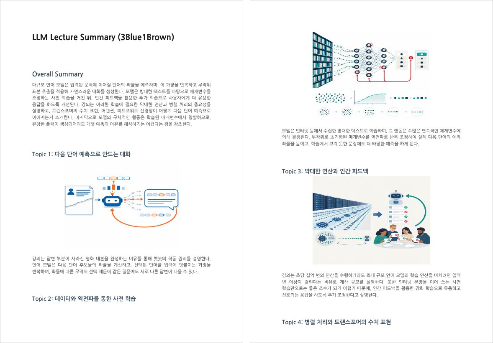

# 🤖 OpenAI API Hands-on


아주대학교 「모바일컴퓨팅특론」 수업에서 진행했던 OpenAI API 실습 자료입니다.

Responses API로 텍스트를 생성하는 기본부터 Function Calling, 이미지·음성 생성까지 단계별로 다루고, 마지막에는 배운 내용을 엮어 **유튜브 강의를 PDF 요약본으로 만드는 프로젝트**를 진행합니다.
모든 노트북은 2026년 10월 기준 OpenAI API(GPT-6, gpt-image-2.5, gpt-transcribe 등)로 작성되어 있고, Colab에서 바로 실행할 수 있습니다.

<br>

## 📚 Curriculum

- **Lecture** 노트북은 설명과 코드, 실행 결과가 함께 들어 있습니다.
- **Practice ✍️** 노트북은 `TODO` 빈칸을 직접 채우는 실습이고, 정답은 [`Practice_solution/`](Practice_solution/)에 있습니다.

### Part 1. Text Generation

OpenAI API의 기본 사용법을 익힙니다. Responses API로 텍스트를 생성하고, 주요 파라미터와 멀티턴 대화, 프롬프트 작성법을 거쳐 Function Calling으로 모델을 외부 함수와 연결하는 방법까지 다룹니다.

| 노트북 | 내용 | |
| --- | --- | --- |
| [00 · OpenAI API Quick Start](1_Text_Generation/00-OpenAI%20API%20Quick%20Start.ipynb) | Responses API 기본 호출, 이미지 입력, 웹 검색, 스트리밍 | [](https://colab.research.google.com/github/nawooooojin/openai-api-hands-on/blob/main/1_Text_Generation/00-OpenAI%20API%20Quick%20Start.ipynb) |
| [01 · Text Generation](1_Text_Generation/01-Text%20Generation-Lecture.ipynb) | 주요 파라미터, 모델 비교, `reasoning.effort` / `text.verbosity`, 멀티턴 대화, 프롬프트 엔지니어링 | [](https://colab.research.google.com/github/nawooooojin/openai-api-hands-on/blob/main/1_Text_Generation/01-Text%20Generation-Lecture.ipynb) |
| [02 · Chatbot Practice ✍️](1_Text_Generation/02-Chatbot-Practice.ipynb) | 멀티턴 챗봇 클래스 구현, `ipywidgets` 챗봇 UI | [](https://colab.research.google.com/github/nawooooojin/openai-api-hands-on/blob/main/1_Text_Generation/02-Chatbot-Practice.ipynb) |
| [03 · Function Calling](1_Text_Generation/03-Function%20Calling-Lecture.ipynb) | Tool 정의 → 호출 → 결과 전달 흐름, `tool_choice` / `allowed_tools` | [](https://colab.research.google.com/github/nawooooojin/openai-api-hands-on/blob/main/1_Text_Generation/03-Function%20Calling-Lecture.ipynb) |
| [04 · Function Calling Practice ✍️](1_Text_Generation/04-Function%20Calling-Practice.ipynb) | 실시간 날씨 API(Open-Meteo) → 활동 추천으로 이어지는 Tool 체인 | [](https://colab.research.google.com/github/nawooooojin/openai-api-hands-on/blob/main/1_Text_Generation/04-Function%20Calling-Practice.ipynb) |

### Part 2. Multimodal Generation

텍스트 외에 이미지와 음성을 다룹니다. 이미지를 생성·편집·분석하고, 텍스트를 음성으로(TTS), 음성을 텍스트로(STT) 바꾸는 실습을 합니다.
Video Generation은 Sora 2 API가 2026년 9월에 종료되어, 수업 당시의 코드와 실행 결과만 남겨두었습니다.

| 노트북 | 내용 | |
| --- | --- | --- |
| [01 · Image Generation](2_Multimodal_Generation/01-Image%20Generation-Lecture.ipynb) | 이미지 생성, 투명 배경, 멀티턴 편집, 스트리밍, 레퍼런스 이미지 편집, 이미지 분석 | [](https://colab.research.google.com/github/nawooooojin/openai-api-hands-on/blob/main/2_Multimodal_Generation/01-Image%20Generation-Lecture.ipynb) |
| [02 · Video Generation](2_Multimodal_Generation/02-Video%20Generation-Lecture.ipynb) | Sora 2 비동기 job 생성 → polling → 다운로드, 이미지 레퍼런스, Remix (아카이브) | |
| [03 · TTS & STT](2_Multimodal_Generation/03-TTS_STT-Lecture.ipynb) | Speech API / Realtime API로 음성 생성, `gpt-transcribe` 전사, prompt·keywords로 신조어 인식 개선, GPT 후처리 | [](https://colab.research.google.com/github/nawooooojin/openai-api-hands-on/blob/main/2_Multimodal_Generation/03-TTS_STT-Lecture.ipynb) |

### Part 3. Project

앞에서 배운 STT, Structured Output, 이미지 생성을 하나의 파이프라인으로 엮습니다. 유튜브 강의 오디오를 받아 전사하고, 내용을 토픽별로 요약한 뒤 토픽마다 이미지를 만들어 PDF 요약본으로 정리합니다.

| 노트북 | 내용 | |
| --- | --- | --- |
| [YouTube Summarization ✍️](3_Youtube_Summarization_Project/youtube_summarization_project.ipynb) | 유튜브 오디오 추출 → STT → 요약·토픽 분리 → 토픽별 이미지 생성 → PDF 요약본 | [](https://colab.research.google.com/github/nawooooojin/openai-api-hands-on/blob/main/3_Youtube_Summarization_Project/youtube_summarization_project.ipynb) |

<br>

## 🖼️ Examples

**Image Generation** — 텍스트로 생성한 이미지, 투명 배경 스프라이트, 멀티턴 편집(만화풍 → 실사), 레퍼런스 이미지를 조합한 편집 결과


**YouTube Summarization** — 3Blue1Brown의 LLM 강의를 넣어서 만든 PDF 요약본



<details>
<summary><b>Video Generation (2025년 Sora 2로 생성)</b></summary>
<br>

</details>

<br>

## 🚀 Getting Started

실습에는 OpenAI API 키가 필요합니다. ([API 키 발급](https://platform.openai.com/api-keys))

### Colab

1. 위 표에서 노트북의 **Open in Colab** 배지를 클릭합니다.
2. 왼쪽 사이드바 🔑 **보안 비밀**에 `OPENAI_API_KEY`를 추가하고 노트북 액세스를 허용합니다.
3. 위에서부터 순서대로 실행합니다. 실습 데이터가 필요한 노트북은 첫 셀에서 레포를 자동으로 받아옵니다.

### Local

```bash
git clone https://github.com/nawooooojin/openai-api-hands-on.git
cd openai-api-hands-on
pip install -r requirements.txt

export OPENAI_API_KEY="sk-..."   # Windows PowerShell: $env:OPENAI_API_KEY="sk-..."
jupyter lab
```

환경 변수를 설정하지 않으면 노트북 실행 시 키를 입력하는 창이 뜹니다.

<br>

## 📁 Structure

```
openai-api-hands-on/
├── 1_Text_Generation/
│   ├── 00-OpenAI API Quick Start.ipynb
│   ├── 01-Text Generation-Lecture.ipynb
│   ├── 02-Chatbot-Practice.ipynb
│   ├── 03-Function Calling-Lecture.ipynb
│   ├── 04-Function Calling-Practice.ipynb
│   └── data/
├── 2_Multimodal_Generation/
│   ├── 01-Image Generation-Lecture.ipynb
│   ├── 02-Video Generation-Lecture.ipynb
│   ├── 03-TTS_STT-Lecture.ipynb
│   └── data/
├── 3_Youtube_Summarization_Project/
│   └── youtube_summarization_project.ipynb
├── Practice_solution/
├── assets/
└── requirements.txt
```

<br>

## 📄 License

MIT License
